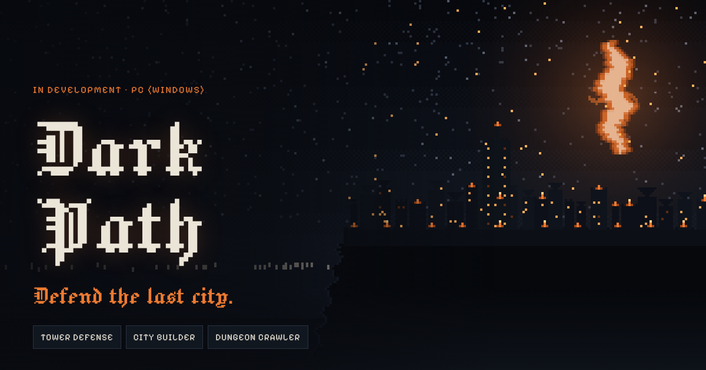

# Dark Path

**Defend the last city.**

Dark Path is a 2D dark-fantasy tower defense, city builder and dungeon crawler for PC (Windows), in development in Godot 4.

A tear in the sky called the Maw has released the Hollow, monsters of ash and bone. Greywatch is the last city standing, and the next invasion arrives in 30 days. Each day you choose: build the city, or send heroes into the dungeons for power and loot. When the countdown ends, you command towers, heroes and militia in a real-time siege.

**Website:** https://mclianmalvar.github.io/darkpath/

## This repository

This repository holds the game's official website, served with GitHub Pages from the `main` branch.

| Path | What it is |
|------|------------|
| `index.html` | Home page: the countdown, city map, torch meter, Bestiary, cast and roadmap |
| `devlog.html` | Devlog: development news, newest first |
| `presskit.html` | Press kit: fact sheet, descriptions, features, credits and downloadable art |
| `faq.html` | Frequently asked questions |
| `404.html` | The page shown for a missing address |
| `assets/site.css` | Styles shared by every page |
| `assets/site.js` | Behavior shared by every page: sound, menus, motion |
| `assets/home.js` | The home page's pixel scenes and interactive pieces |
| `presskit/` | Logos, icon, key art, social card and a zip of all of them |
| `og.png` | The preview image shown when a link to the site is shared |

### Adding a devlog post

Open `devlog.html`, copy one `<article class="post">` block, paste it at the top of the list, and change its `id`, date, tags, title and text.

### Changing the Follow button

To send the home page's Follow button to an itch.io page or a Discord server instead of this repository, set `FOLLOW_URL` near the bottom of `assets/site.js`.

## Status

The game design document reached v1.0 on October 19, 2026. Next up is Milestone 1, the defense prototype.

---

Designed and developed by Mc Lian M. Malvar. All characters, setting and story are original.
